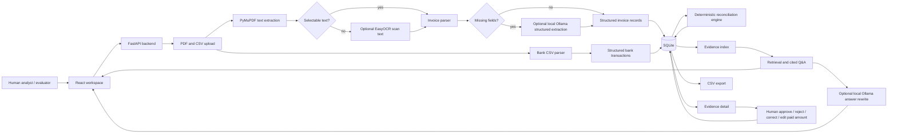

# Architecture

## Target User And Problem

FinGuard is for finance operators, bookkeepers, accountants, and evaluators who need to reconcile vendor invoice PDFs against outgoing bank transactions. The prototype focuses on explainable invoice-to-bank reconciliation, not payment execution, ledger posting, tax filing, or GST/legal advice.

## System Diagram

## Human And AI Boundaries

The human acts at upload, inspection, and final review. The analyst can approve, reject, correct a suggested match, select a candidate bank transaction, edit paid amount, and leave review notes. Review decisions are stored separately from the original system suggestion so the audit trail preserves both.

The AI acts only in bounded support roles:

- Optional local Ollama can fill missing invoice fields from text already extracted from the PDF.
- Optional local Ollama can rewrite a retrieved, cited Q&A answer into clearer language.

The AI does not approve records, calculate authoritative totals, invent citations, or change final payment status. Payment status is produced by deterministic code and remains human-reviewable.

## Data Flow

1. The backend initializes SQLite and auto-loads the sample workspace if the database is empty.
2. Invoice PDFs are parsed with PyMuPDF. If a PDF has no selectable text and EasyOCR is installed, pages are rendered and OCR is attempted.
3. The invoice parser extracts vendor, invoice number, invoice date, tax, total, currency, raw text, filename, and page number.
4. If required fields are missing and Ollama is available, the extracted text is sent to local Ollama for strict JSON field extraction.
5. Bank CSV files are parsed into transaction date, description, debit, credit, reference, original filename, and CSV row number.
6. The deterministic reconciliation engine compares invoice and bank records.
7. Results, evidence snippets, and review decisions are persisted in SQLite.
8. The frontend displays the workspace, evidence detail, Q&A, review controls, and CSV export.

## Deterministic Reconciliation

The reconciliation engine determines suggested status and amounts using:

- invoice number and payment reference overlap,
- vendor token overlap,
- payment date window,
- exact amount, partial amount, near mismatch, overpayment, or mismatch logic,
- duplicate or ambiguous candidate detection.

Statuses include:

- `matched`
- `partially_paid`
- `unpaid`
- `needs_review`
- `unmatched_bank`

Ambiguous candidates, duplicate-looking candidates, missing invoice numbers, and amount mismatches are marked for review rather than silently resolved.

## Retrieval And RAG Boundary

The evidence index stores invoice text, bank transaction text, and local workspace policy snippets in SQLite. Evidence Q&A retrieves relevant records first. If Ollama is available, it rewrites the grounded answer while using only the retrieved evidence and deterministic answer. Citations include invoice page numbers or bank CSV row numbers.

Structured totals and payment statuses come from SQLite and the reconciliation engine, not from a generative answer.

## Technology Choices

- React, TypeScript, Vite, Tailwind, and lucide-react provide a responsive analyst workspace.
- FastAPI and Pydantic provide a small typed API surface.
- SQLite keeps the prototype easy to run locally and inspect.
- PyMuPDF handles normal text-based invoice PDFs.
- EasyOCR is optional for scanned invoice PDFs.
- Ollama is optional and avoids cloud LLM API keys.
- Pytest covers parsing, reconciliation, review persistence, Q&A citations, and export.

## Alternatives Rejected

- Pure LLM reconciliation was rejected because payment status and amounts need deterministic, inspectable logic.
- A vector database was rejected because the prototype workspace is small and keyword retrieval is sufficient.
- PostgreSQL, Docker, and cloud deployment were rejected to keep the public submission easy to run locally.
- Fully automated approval was rejected because finance workflows need human accountability.
- External LLM APIs were avoided to reduce confidential-data exposure.

## Main Limitations

- One active local workspace, not multi-user workspace history.
- CSV bank upload only; scanned bank statement PDF parsing is not implemented.
- OCR is optional and depends on local EasyOCR quality.
- Vendor matching is conservative and can miss uncommon abbreviations.
- Review decisions do not post to an accounting ledger.
- This prototype does not provide tax, GST, legal, or banking advice.
