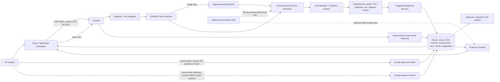

# FinGuard Architecture

FinGuard is one local application with two linked workflows: **invoice-to-PO approval** and **invoice-to-bank payment reconciliation**. A single invoice record can have an approval suggestion, a later human decision, and a separate payment status. Approval never sets payment status; a matching bank transaction never sets approval status.

## System diagram



**Solid arrows** are required runtime paths. **Dotted arrows** are optional local AI assistance. The deterministic engines, not the model, calculate money and decide suggested outcomes. The human owns final exception decisions.

## Data flow

1. The API validates PDF extension, header and size; it stores the original bytes and SHA-256 hash in `source_files`. Bad PDFs become failed runs, not successful invoices.
2. A processing run is created per PDF. The backend writes real `approval_events` with running, completed or failed states at ten stages. The React live run view polls these persisted events.
3. PyMuPDF extracts text page by page. If the PDF has no selectable text, EasyOCR is attempted only when installed with local weights. Missing or poor OCR leaves fields null and sends the case to review.
4. The parser extracts core fields with local rules. If needed and available, the approval pipeline calls Ollama once to propose additional fields from the raw text. Pydantic validates the structured result. Model-supplied fields trigger analyst review. Original text, extraction method, warnings and page references are preserved.
5. The approval engine verifies the vendor master, finds a PO (exact reference first, controlled implied candidate second), checks duplicate identity and source hash, calculates remaining PO balance with `Decimal`, applies tolerance and tax/line checks, and emits **Approved**, **Needs review** or **Rejected** with reason codes and explanations.
6. The original suggestion is stored in `approvals`. Human edits and final decisions are append-only entries in `approval_reviews`; the original extraction and suggestion remain intact. Corrections to shared invoice fields update the linked invoice record and recalculate payment suggestions without removing human payment reviews.
7. Bank CSV imports create `bank_transactions`. The existing reconciliation engine matches invoice references, vendor text, payment date and amount, supports partial or multiple payments, and emits a **separate** payment outcome. A bank transaction with an explicit invoice reference cannot be counted against another invoice from the same vendor; shared unreferenced transactions need review.
8. `review_decisions` hold human payment decisions. CSV reports read persisted records and final human statuses. Evidence Q&A retrieves indexed invoice and bank evidence, with optional local Ollama wording.

## Procurement logic

- **Vendor:** GSTIN or normalized legal name identifies a vendor. An approximate name alone is a review case. Unapproved or inactive vendor is a hard stop.
- **PO:** An explicit PO reference takes priority. Without it, one eligible vendor/currency/date PO can be suggested, but still requires review. Multiple candidates are shown without choosing arbitrarily. Closed or cancelled POs, or a PO belonging to another verified vendor, are hard stops.
- **Balance:** Remaining PO amount equals approved amount minus opening invoiced value and previously **approved** invoice totals. A second invoice against the same PO is valid if within the balance. The threshold is the greater of the PO's absolute and percentage tolerances.
- **Duplicates:** A repeated source hash or same vendor plus normalized invoice number is a confirmed duplicate and rejected. Same vendor/date/amount is a possible duplicate and needs review. A shared PO number alone is not a duplicate.
- **Tax and lines:** Subtotal plus tax is checked against total. If available, tax is compared with the PO rate and tax treatment. Item descriptions and line arithmetic are checked; unreliable bundled comparisons stay in review. No missing value is silently invented.
- **Decisions:** Hard stops yield Rejected. Missing, ambiguous or inconsistent evidence yields Needs review. Only a case with no material warning or hard stop can be automatically Approved.

## Persistence model

```text
source_files (original bytes, hash, filename)
  └─ invoices (shared invoice identity and parsed amount)
       ├─ approvals (immutable extraction + machine suggestion, one per processed PDF)
       │    ├─ approval_runs → approval_events
       │    └─ approval_reviews (append-only human corrections and final decision)
       └─ reconciliation_results (separate payment suggestion)
            └─ review_decisions (append-only human payment decision)
vendors ── purchase_orders ── approvals.matched_po
bank_transactions ── reconciliation_results
evidence_index (retrieval snippets)
```

SQLite is local and ignored by Git. The demo CSVs/PDFs and scenario manifest are included in `sample_data`. On a fresh empty database, only three selected PDFs are processed through the same backend path as user documents; vendor and PO reference data load, while the remaining PDFs and bank CSV wait for manual upload. **Reload demo** explicitly clears and reconstructs that three-invoice, no-bank state; normal uploads append. An exact repeat of an already imported bank CSV is skipped by its SHA-256 fingerprint.

## Failure and uncertainty handling

- Invalid PDF: failed run and visible error; no fabricated invoice.
- No OCR: an invoice record with missing fields and warnings; Needs review.
- Invalid or unavailable Ollama response: rule-based extraction continues; the UI does not claim model use.
- Ambiguous vendor, PO or payment: Needs review with candidates.
- Duplicate or invalid vendor/PO: hard-stop rejection.
- Finance arithmetic: `Decimal`, source values retained, differences and tolerance shown.
- Review: original system recommendation and human final decision are separate records.

## Alternatives considered

- **Pure LLM approval:** rejected because financial arithmetic and policy need reproducible, testable rules.
- **Vector database / agents / microservices:** rejected for this local prototype; the evidence volume is small and SQLite retrieval is sufficient.
- **Auto-selecting a fuzzy vendor, PO or bank payment:** rejected because a plausible but wrong match can create a false approval or double count a payment.
- **Precomputed dashboard statuses:** rejected; sample PDFs run through the parser and rules, with real persisted events.
- **Cloud OCR or paid LLM:** rejected as required dependencies for a reproducible local evaluation.

## Before production

Validate extraction on a representative, permissioned invoice corpus; measure false approvals, duplicate misses and OCR failure rates. Integrate an authoritative ERP/vendor master and formal PO policy. Add authentication, tenant isolation, access control, encryption, retention, backups, durable job queue, migrations, monitoring and human-review SLAs. Get tax and legal review of policy rules. Do not use this prototype to execute payments.
